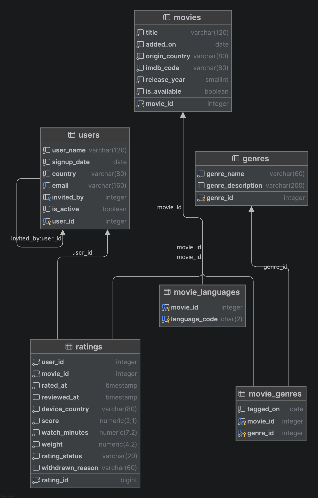

# EX603 Movie/TV Ratings Platform: SQL Analysis

A PostgreSQL analysis of a movie and TV ratings platform, tracing a
dashboard's false "50% spam" alarm to its real cause and building the
breakdowns, trends, and recommendations that followed.

**Author:** Jordan Kahng
**Course:** EX603 Data and Algorithms for Scalable Systems

## The Domain

This project models a streaming and media discovery platform where users
browse a catalog of movies and TV titles, explore them by genre, and submit
ratings. Each rating carries a score from 0.5 to 5.0, a timestamp, the
viewer's country, and a status. A rating can be published, flagged for
review while staying live, or withdrawn. Withdrawn ratings record a reason,
such as spam, a duplicate, or a user request.

The analysis starts from a problem: the platform's dashboard reported that
about half of all ratings were spam, and reviewer payouts were frozen based
on that number. Over Units 3–6, I used SQL to check that claim against the
raw data, find what caused the error, and answer the questions leadership
asked next.

The platform needs to answer:
- **What is the true spam failure rate**, and why did the dashboard get it
  wrong?
- **Which movies contribute the most to it**, and does anything about those
  movies explain why?
- **Which movies have never been rated at all**, and why do standard reports
  miss them?
- **Is the spam problem getting better or worse over time**, and what should
  the team do next quarter?

## Database Overview

The analysis runs on `ex603_data`, a PostgreSQL dataset provided by the
course in Unit 3. The full table definitions (DDL) and data are in
[`schema/movies.sql`](schema/movies.sql).



The analysis maps the platform onto five roles:

| Role | Table | Rows | What it holds |
|---|---|---|---|
| **Actor** | `users` | 30 | Accounts that submit ratings, with signup date and country |
| **Producer** | `movies` | 15 | The catalog: title, release year, origin country, and an `is_available` flag |
| **Event** | `ratings` | 200 | Every rating: score (0.5–5.0), timestamp, viewer's country, `rating_status`, and `withdrawn_reason` |
| **Catalog** | `genres` | 5 | Genre names (Comedy, Documentary, Drama, Sci-Fi, Thriller) |
| **Junction** | `movie_genres` | 25 | Links movies to genres, since one movie can have several genres |

Two columns in `ratings` drive most of the findings:
- **`rating_status`** is `published`, `flagged` (under review but still
  live), or `withdrawn`.
- **`withdrawn_reason`** is only filled in for withdrawn ratings ("Spam
  detected," "Duplicate rating," "User request," or "Policy violation"). It
  is empty (NULL) for every other rating, and that is what caused the
  dashboard's error.

Every withdrawn rating also carries a placeholder score of 0.5 rather than
a real score, which pulls down averages unless it is filtered out.

### My own schema design (Units 1–2)

Before the course dataset was provided, I designed my own schema for this
theme in [`schema/schema.sql`](schema/schema.sql). Key decisions included
soft deletes through an `is_active` flag, `ON DELETE CASCADE` from users to
ratings but `ON DELETE RESTRICT` from movies to ratings, and a surrogate
`rating_id` key with a `UNIQUE (user_id, movie_id)` constraint. The
reasoning is in [`schema/constraints.md`](schema/constraints.md), and the
original diagram is [`schema/erd.png`](schema/erd.png).

## Project Structure
```text
ex603-movie-tv-database/
├── README.md
├── schema/          # DDL scripts, ERD diagrams, and constraint documentation
├── queries/         # SQL query scripts organized by unit (unit3, unit4, unit5, unit6)
├── analysis/        # Markdown reflections and analytical writeups
└── screenshots/     # Execution evidence and verification output
```

## Query Catalogue

Throughout the project, a **failure** is a rating withdrawn as spam
(`withdrawn_reason = 'Spam detected'`), a **producer** is a movie, and an
**event** is a rating. Click a file name to open the SQL.

### Unit 3: Filtering, NULLs, and subqueries

| Query | File | Business question |
|---|---|---|
| 3.1a | [q3_1.sql](queries/unit3/q3_1.sql) | Which available movies were released after 2015, newest first? |
| 3.1b | [q3_1.sql](queries/unit3/q3_1.sql) | What rating statuses actually exist in the data? |
| 3.1c | [q3_1.sql](queries/unit3/q3_1.sql) | Which ratings scored between 4.0 and 5.0, and which are withdrawn or flagged? |
| 3.1d | [q3_1.sql](queries/unit3/q3_1.sql) | Which titles match a pattern, which ratings have no withdrawal reason, and how can missing reasons be labeled? |
| 3.1e | [q3_1.sql](queries/unit3/q3_1.sql) | How can scores and watch time be described in plain language? |
| 3.2A | [q3_2.sql](queries/unit3/q3_2.sql) | Why does counting "not spam" ratings silently drop 166 rows, and how is it fixed? (the dashboard's bug) |
| 3.2B | [q3_2.sql](queries/unit3/q3_2.sql) | Why can't WHERE use a column alias, and what are two ways around it? |
| 3.3-1 to 3.3-3 | [q3_3.sql](queries/unit3/q3_3.sql) | Which users wrote a spam rating? (answered three ways: IN, a CTE, and EXISTS) |
| 3.3-4 | [q3_3.sql](queries/unit3/q3_3.sql) | Do all three forms return exactly the same users? (proved with EXCEPT in both directions) |

### Unit 4: Aggregation

| Query | File | Business question |
|---|---|---|
| 4.1-1 | [q4_1.sql](queries/unit4/q4_1.sql) | What does the whole platform look like in one row (count, total, average, min, and max score, plus distinct users)? |
| 4.1-2 | [q4_1.sql](queries/unit4/q4_1.sql) | Which movies get the most ratings, and how do their average scores compare? |
| 4.1-3 | [q4_1.sql](queries/unit4/q4_1.sql) | Which movies have at least 10 ratings, making their average scores less sensitive to individual ratings? |
| 4.1-4 | [q4_1.sql](queries/unit4/q4_1.sql) | How do rating counts and scores vary by the movie's region and the viewer's region together? |
| 4.2A | [q4_2.sql](queries/unit4/q4_2.sql) | For each movie, how many ratings did it get, how many were spam failures, and what percentage were spam? |
| 4.2B | [q4_2.sql](queries/unit4/q4_2.sql) | What are the spam totals and rates for each region and for the whole platform? |
| 4.2C | [q4_2.sql](queries/unit4/q4_2.sql) | Among movies with at least 10 ratings, what is the average spam rate to use as a baseline? |

### Unit 5: Joins

| Query | File | Business question |
|---|---|---|
| 5.1-1 | [q5_1.sql](queries/unit5/q5_1.sql) | For each rating, which user made it, which movie was it for, and when? |
| 5.1-2 | [q5_1.sql](queries/unit5/q5_1.sql) | Which genres is each movie tagged with? |
| 5.1-2b | [q5_1.sql](queries/unit5/q5_1.sql) | Which movies share the Comedy tag with the two spam outliers, and does that genre explain their spam? |
| 5.1-3 | [q5_1.sql](queries/unit5/q5_1.sql) | Do the outlier movies share a region with other movies, and do those movies also have spam problems? |
| 5.2A | [q5_2.sql](queries/unit5/q5_2.sql) | How many movies does an INNER JOIN silently exclude compared with a LEFT JOIN, and which ones? |
| 5.2B | [q5_2.sql](queries/unit5/q5_2.sql) | Does a RIGHT JOIN match the LEFT JOIN exactly, and what does a FULL OUTER JOIN reveal from both sides? |
| 5.2C | [q5_2.sql](queries/unit5/q5_2.sql) | Which movies have never been rated? (answered with NOT EXISTS and EXCEPT) |
| 5.3A | [q5_3.sql](queries/unit5/q5_3.sql) | What does a CROSS JOIN produce, and does its row count equal movies × genres? |
| 5.3B | [q5_3.sql](queries/unit5/q5_3.sql) | Which join algorithms does PostgreSQL choose for the three-table join, and why? |

### Unit 6: Window functions

| Query | File | Business question |
|---|---|---|
| 6.1-1a/1b | [q6_1.sql](queries/unit6/q6_1.sql) | Is each rating unusually high or low for its own movie, and what does GROUP BY lose by comparison? |
| 6.1-2 | [q6_1.sql](queries/unit6/q6_1.sql) | How do ROW_NUMBER, RANK, and DENSE_RANK order a movie leaderboard when movies tie? |
| 6.1-3 | [q6_1.sql](queries/unit6/q6_1.sql) | Which movies fall into each quarter of activity, and what happens to ties at a band boundary? |
| 6.2A | [q6_2.sql](queries/unit6/q6_2.sql) | Is movie 2's score trending up or down from one rating to the next? |
| 6.2B | [q6_2.sql](queries/unit6/q6_2.sql) | How close does each quarter get to a 50-rating target, and is the recent average score rising or falling? |
| 6.2C | [q6_2.sql](queries/unit6/q6_2.sql) | Which movies went 60+ days without a rating before ratings resumed? |
| 6.3A | [q6_3.sql](queries/unit6/q6_3.sql) | What are each movie's top three ratings? |
| 6.3B | [q6_3.sql](queries/unit6/q6_3.sql) | Is the platform getting better or worse each month, in rating volume and spam rate? |

## Technical Highlights

**1. NULL-aware filtering: finding the dashboard's bug (Unit 3)**
The dashboard counted "ratings not withdrawn as spam" with
`WHERE withdrawn_reason <> 'Spam detected'`. Because `withdrawn_reason` is
NULL for every rating that was never withdrawn, and comparing NULL with
`<>` gives UNKNOWN rather than TRUE, that filter silently dropped 166 of
200 ratings and returned 22 instead of 188. Adding
`OR withdrawn_reason IS NULL` fixed it. This one missing condition
explains how the dashboard reached its false "50% spam" figure.

**2. Conditional aggregation: several answers in one pass (Unit 4)**
```sql
SELECT movie_id,
       COUNT(*) AS total_ratings,
       SUM(CASE WHEN withdrawn_reason = 'Spam detected' THEN 1 ELSE 0 END) AS spam_failures
FROM ratings
GROUP BY movie_id;
```
Putting the condition inside the aggregate, instead of in WHERE, counts
each movie's total ratings and spam failures side by side in a single scan
of the table. That made it possible to calculate every movie's spam rate
directly, which revealed movies 2 and 3 as outliers at 18.8% and 15.4%.

**3. Outer joins and anti-joins: finding what reports leave out (Unit 5)**
An INNER JOIN between movies and ratings returned 13 movies, quietly
dropping the two that had never been rated. A LEFT JOIN kept all 15, and
counting `COUNT(r.rating_id)` instead of `COUNT(*)` correctly gave those
two movies 0 ratings instead of 1. NOT EXISTS, EXCEPT, and a FULL OUTER
JOIN all confirmed the same result: movies 14 and 15 have no activity.

**4. CTEs: breaking problems into steps (Units 3–6)**
Common Table Expressions (the `WITH` clause) let me compute an
intermediate result, then filter or aggregate it in a second step. I used
them for a per-movie baseline spam rate (an average of averages, which a
single GROUP BY can't do), and for filtering on window function results,
which WHERE can't see in the same query.

**5. Window functions: trends without losing detail (Unit 6)**
Window functions calculate across related rows while keeping every row.
`PARTITION BY` compared each rating with its own movie's average. A running
total that resets each quarter tracked progress toward a 50-rating target.
`LAG` compared each month with the one before, with a check to catch
missing months. Grouping those monthly results by quarter showed the spam
rate falling from 7.5% to 4.2% over the year.

## Findings and Recommendations

**1. The real spam rate is 6%, not 50%, and it is falling.**
Only 12 of 200 ratings were withdrawn as spam. The dashboard's figure came
from a filter that silently excluded every rating without a withdrawal
reason. Across 2023, the quarterly spam rate fell from 7.5% to 6.3%, 5.9%,
and 4.2%, while rating activity stayed steady at about 50 per quarter.
Because the trend rests on only 12 spam ratings, it is encouraging rather
than conclusive.
*Recommendation:* keep monitoring spam each quarter and investigate right
away if the rate rises above 6%. Check any dashboard number against the
raw data before it drives a decision like freezing payouts.
([Unit 3 memo](analysis/unit3-finding.md),
[Unit 6 memo](analysis/unit6-finding.md))

**2. Spam is concentrated in two movies, and nothing about the movies explains it.**
Movies 2 and 3 had spam rates of 18.8% and 15.4%, about three times the
platform rate, and they were the only movies with more than one spam
rating. Other movies with the same genre or from the same country had
little or no spam, which points to the rating activity around these two
movies rather than their content.
*Recommendation:* review new ratings on movies 2 and 3 and investigate the
accounts behind their spam, rather than removing the movies.
([Unit 4 memo](analysis/unit4-finding.md),
[Unit 5 memo](analysis/unit5-finding.md))

**3. Two movies have never been rated, and standard reports hide them.**
Movies 14 and 15 are in the catalog but have zero ratings. Any report built
on an INNER JOIN leaves them out completely, so they never appeared in the
earlier analysis. This is a visibility problem, not a spam problem, and
needs a different response.
*Recommendation:* confirm both movies are available and easy to find, then
promote them. Start tracking views as well as ratings, so the team can tell
whether a movie is being ignored, hard to find, or watched without being
rated. ([Unit 5 memo](analysis/unit5-finding.md))

## Limitations and Future Improvements

**The main limitation is sample size.** The dataset holds 200 ratings across
15 movies over one year, and only 12 of those ratings were withdrawn as
spam. That is enough to show the dashboard was wrong, but not enough to be
confident about smaller patterns. A single spam rating moves a month's spam
rate by 5–9 percentage points, which is why I compared quarters rather than
months. The same is true of the falling quarterly trend (7.5% to 4.2%) and
of movies 2 and 3 standing out: each rests on just two or three ratings.

**What would help:** more data, specifically several years of ratings or a
larger catalog, so trends could be tested against more than a handful of
spam events. With more volume, I could also break spam down by account to
see whether a few users are behind most of it, and use statistical tests
to check whether a change is larger than normal random variation.

Two smaller limitations are also worth noting:
- **Only ratings are recorded, not views.** A movie with no ratings might be
  unwatched, hard to find, or watched without being rated. The data can't
  tell these apart.
- **Withdrawn ratings carry a placeholder score of 0.5.** Any average that
  includes them is pulled down. I filtered them out where it mattered, but
  storing withdrawn scores as NULL instead of 0.5 would prevent the
  problem at the source.

## Video Presentation

A 3–5 minute walkthrough of the analysis, covering the key queries, the
main findings, and recommendations for next quarter:

**[Watch the presentation](VIDEO_LINK_HERE)**

## How to Run It

**Requirements:** PostgreSQL 14 or later, with the `createdb` and `psql`
command-line tools.

**1. Download the repository**
```bash
git clone https://github.com/jkahng-code/EX603-Movie-TV-database.git
cd EX603-Movie-TV-database
```

**2. Create the database and load the dataset**

This creates the tables and inserts all the data. It is safe to re-run,
because the script drops existing tables first.
```bash
createdb ex603_data
psql -d ex603_data -f schema/movies.sql
```

**3. Run a query file**

Each file in `queries/` runs as-is against the loaded dataset. The one
exception is query 3.2B-1 in `queries/unit3/q3_2.sql`, which is meant to
fail: it demonstrates the "column does not exist" error that the next two
queries fix. psql reports the error and continues with the rest of the file. 

For example, to run the Unit 4 spam breakdown:
```bash
psql -d ex603_data -f queries/unit4/q4_2.sql
```

Or open `psql -d ex603_data` and run a single query directly, such as the
platform-wide spam rate:
```sql
SELECT COUNT(*) AS total_ratings,
       SUM(CASE WHEN withdrawn_reason = 'Spam detected' THEN 1 ELSE 0 END) AS spam,
       ROUND(100.0 * SUM(CASE WHEN withdrawn_reason = 'Spam detected' THEN 1 ELSE 0 END)
             / COUNT(*), 1) AS spam_rate_pct
FROM ratings;
```
This should return `200 | 12 | 6.0`.

Any SQL client, such as DataGrip, pgAdmin, or DBeaver, also works: connect
to the `ex603_data` database and open any `.sql` file from `queries/`.